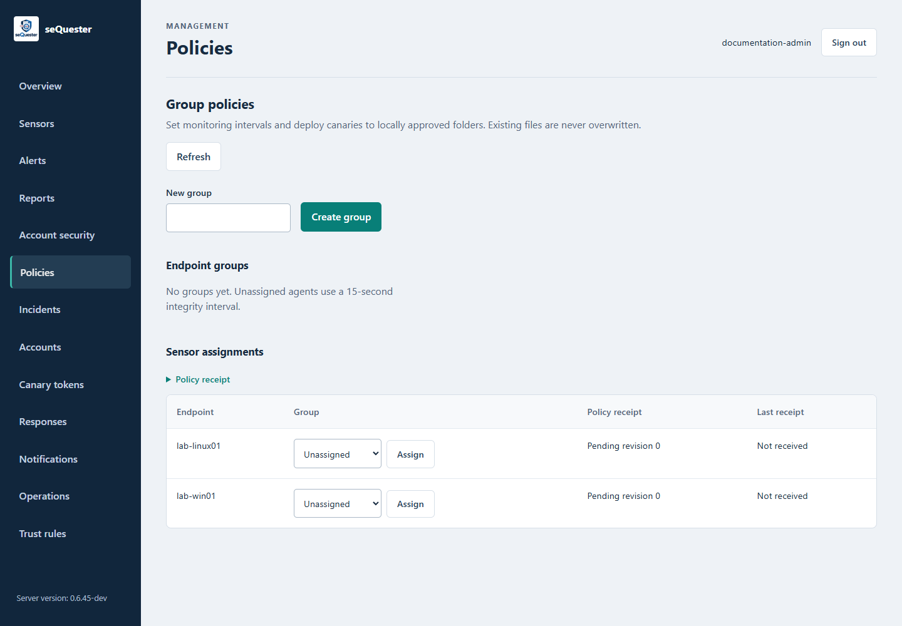
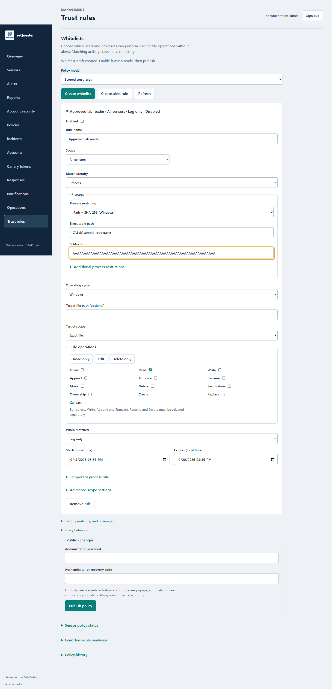
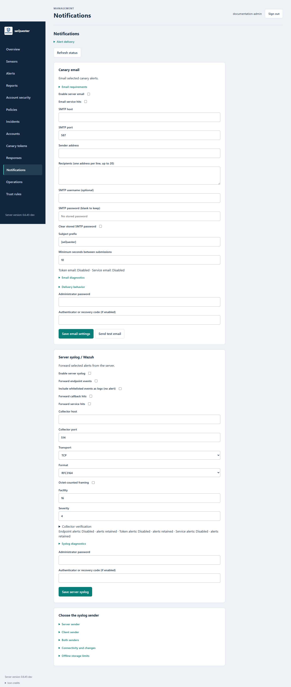

# Administrator guide

## Roles and access

The application defines **Reader**, **Operator** and **Administrator** roles. Read access is broadly shared; mutations have route-specific authorization and verification requirements. Use [API guide](API-GUIDE.md) and the corresponding endpoint implementation for exact permissions.

| Role | Intended use |
| --- | --- |
| Reader | Inspect sensor inventory, events and permitted investigation information. |
| Operator | Investigate and manage workflows explicitly permitted by the server. |
| Administrator | Manage accounts, enrollment, policies, integrations and privileged actions. |

Local accounts, MFA, recovery, directory authentication and configured SSO have separate setup requirements. Do not use the bootstrap key as a regular browser login or distribute it to sensors.

## Enroll a sensor

1. Install the correct sensor package for the host and approved monitoring source.
2. In **Sensors**, choose **Create enrollment code**.
3. Enroll the sensor using that code and the approved management address.
4. Store the returned sensor credential through the platform's protected configuration workflow.
5. Confirm the sensor's host, OS, version and contact time in inventory.
6. Confirm monitoring state and perform a controlled file-access test.

Enrollment establishes a reporting identity. It does not install a native driver, approve monitored folders or demonstrate event collection. Revoke obsolete identities through the management workflow; preserve their historical events.

## Publish a group policy

Open **Policies**, create or select a group, and assign the intended sensors. Configure the monitoring interval and deployments for locally approved folders. Review the revision before publishing.

Publication, receipt and successful application are separate stages. Check each sensor's revision and result. A pending receipt can mean an offline host, credential problem, unsupported policy or failed local prerequisite.

The deployment workflow preserves existing files and requires local folder approval. Do not use decoy deployment to overwrite operational data. Token generation, file deployment and application-trigger testing are separate steps.



## Create a whitelist without an event

1. Open **Trust rules** and choose **Create whitelist**. The new draft is disabled.
2. Give it a specific name, such as **Approved finance reader**.
3. Limit its scope to the intended group or sensor where possible.
4. Choose the user, process, or combined identity and provide the required identifiers.
5. Select target scope and file operations.
6. Set the effective dates and review optional restrictions.
7. Enable the rule and publish with the required administrator verification.
8. Verify policy readiness and the receipts from affected sensors.
9. Test a permitted operation and a nearby operation that should still alert.

Publishing sends a policy revision; it does not establish that every sensor can interpret it. New parser-v4 controls require fresh compatible sensor capability reports. Linux native hash rules also require the specific source-readiness report.



The screenshot's all-`A` SHA-256 is a placeholder for documentation, not a trusted binary digest. Obtain the real digest from a trusted executable.

### Match the right identity

| Control | Meaning |
| --- | --- |
| User | Match the captured identity in its correct authority or sensor context. |
| Process | Match the configured executable evidence. Windows drafts default to path plus SHA-256. |
| User and process | Both identities must match. |
| User or process | Either identity can match; this single-rule control is in the undeployed development candidate. |
| Process owner | Match the primary owner when the source supports that identity. |
| Effective user | Match the identity actually available for the operation; never fall back to the owner when unknown. |

For Windows, use SID and authority context, not just a display name. For Linux, UID matching is sensor-scoped; the same numeric UID on another host is not automatically the same account. Nonleader Linux threads may not have a reliably captured process-owner identity even when effective filesystem credentials are available.

### Verify the executable

Use **Path + SHA-256** to bind a Windows process rule to the expected executable bytes. Optional signer, publisher and parent restrictions add constraints; they do not replace a trusted hash.

```powershell
(Get-FileHash -LiteralPath 'C:\Windows\System32\notepad.exe' -Algorithm SHA256).Hash
```

**Path only** is an explicit mode with no binary verification. It cannot distinguish an expected executable from a different binary placed at the same path. A filename such as `notepad.exe` alone is insufficient.

For interpreters, the executable hash identifies the interpreter, not the script or document it runs. Review command line and linked evidence when those are available.

### Choose operations and scope

**Read only** selects read. **Edit** selects write, append and truncate. **Delete only** selects delete. Other operations must be selected separately.

Exact-file scope and a target path restrict an exception to that resource. The development candidate adds descendant-directory matching with path-boundary checks and short-lived process-instance rules. Temporary rules bind to a sensor, PID, start key and capture session, and expire within 24 hours. These controls are not yet established as deployed features.

The legacy Linux native hash mode covers qualified open observations. The new operation-hash mode is limited to read, write and append and still needs live qualification. It does not claim executable-path, signer or parent matching.

### Understand precedence

Matching log-only activity is retained with its rule identifiers. It suppresses alerts and automatic response for that event. An always-alert rule overrides a simultaneous log-only match.

Wrong or missing identity, digest, operation, scope, time or required source evidence leaves the event outside the exception. A rule cannot supply missing detection coverage. Remote callback activity does not prove a local process identity.

## Manage canary tokens

Configure the callback receiver before creating tokens. In **Canary tokens**, provide name, type and location; add a description or note when it helps responders identify placement. Create the token, download its artifact where supported, and deploy it through an approved policy or placement procedure.

Keep token identifiers and deployment context in the database. Record the intended location; do not assume a callback itself identifies the original host. Revoke retired tokens through the server workflow.

The local template types and the callback catalog are different inventories. A plain text honeypot can be monitored locally without containing a remote trigger. Provider-required and pending callback types are not usable solely because they appear in the catalog. See [Capabilities](CAPABILITIES.md).

## Manage service decoys and jobs

Service decoys and Windows virtual-drive/library jobs have separate configuration, approval, delivery and observation histories. New resources start disabled. Review the target sensor, resources and policy revision before enabling a job.

Use structured **History** to review approvals, delivery, session outcomes and native checks. Diagnostics and raw-history download are secondary views. Job retirement retains backing folders; it is not an instruction to delete operational files.

## Configure notifications

**Notifications** separates canary email from server syslog delivery.

For email, configure the SMTP destination, sender, recipients and authentication. Save the settings, then use **Send test email** and verify actual receipt. Token-specific email selection and service-hit delivery are separate controls.

For syslog, select event categories, collector, transport, format and framing. The candidate includes TLS certificate pinning and a durable-storage receipt option. A collector receipt proves admission to that collector, not Wazuh alert creation or indexing.

Whitelisted events can be forwarded as retained logs without generating an alert. Select one exporter for the same event stream unless downstream deduplication is deliberately configured.



Production Wazuh delivery remains unfinished. Keep the current failure and acceptance boundary visible in [Capabilities](CAPABILITIES.md) and [Wazuh integration](WAZUH-INTEGRATION.md).

## Configure responses carefully

The native response candidate supports policy preview, observation/manual/automatic modes, source-linked preservation checks and process-instance constraints. Default mode is observation. Broader response adapters remain unqualified or unimplemented.

For a supported process-stop workflow, review the exact sensor, event, process birth identity, executable path and digest. Confirm the sensor's local permission, server policy and fresh capability report. Check the execution receipt and exact-process exit independently.

Do not interpret a response queue entry, preview or owned-child test as acceptance of full native file-event response. Account disabling does not imply session revocation, and terminating a process has no true undo.

## Administrative access changes

Keep the original working administrative session open while changing ACLs, credentials or management-access firewall rules. Open a separate fresh session from the affected authorized source and verify authentication, administrative privileges and the intended repair before closing the original.

Where source restrictions matter, verify the source address observed by the target and test the required authorized paths. A banner, existing session or open TCP port is insufficient. If the new session fails, keep the original session and correct or safely roll back the change. Record any access path not tested.
