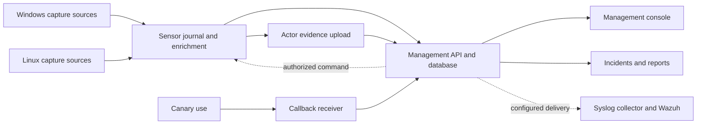

# Architecture and evidence

## Components

seQuester uses a central management server, endpoint sensors and a separate callback receiver. Platform-specific capture components feed shared event, policy and evidence contracts.

The arrows show implemented architecture and integration paths, not universal acceptance of every platform or response adapter. See [Capabilities](CAPABILITIES.md) for qualification boundaries.

| Component | Source |
| --- | --- |
| Management server and console | `src/RansomFree.Server` |
| Shared event, evidence, trust and response models | `src/RansomFree.Contracts` |
| Windows service and client pipeline | `src/RansomFree.Agent`, `src/RansomFree.Client` |
| Windows native capture | `src/RansomFree.WindowsKernel` |
| Linux sensor and native capture | `src/RansomFree.LinuxAgent`, `src/RansomFree.LinuxKernel` |
| Linux audit relay | `src/RansomFree.AuditRelay`, `packaging/linux-client/audit` |
| Callback receiver | `src/RansomFree.Receiver` |
| Windows virtual decoys | `src/RansomFree.DecoyHost`, `src/RansomFree.WindowsDecoys` |
| Desktop and tray interfaces | Root desktop project, `src/RansomFree.Tray`, `src/RansomFree.UnixDesktop` |
| macOS development components | `src/RansomFree.MacAgent`; qualification is separate from Windows/Linux. |
| Wazuh collector resources | `packaging/wazuh` |

## Event lifecycle

1. A configured source observes a monitored operation or callback.
2. The sensor captures available ephemeral identity and operation data.
3. The journal retains the observation while managed enrichment collects executable metadata and evidence.
4. Trust evaluation records policy identity, matching rules and disposition.
5. The sensor sends a batch using its enrolled identity. Capability-aware receipts prevent unsupported evidence from being treated as delivered.
6. The server stores the event, its received time and sequence. Duplicate identifiers are handled separately from conflicting reuse of an identifier.
7. Evidence enrichment and binary-upload results remain linked to the source event.
8. The console, reports and integrations present the stored observation and its collection status.

An alert is not the same object as a captured observation, an enrichment record or a response receipt. Keep these stages distinguishable during investigation and SIEM mapping.

## Durable process identity

PID is a temporary handle. Process-instance evidence includes host/sensor context, PID, creation/start identity, parent relationship and available session data. Capture sessions identify source lifetimes; they are not automatically OS boot UUIDs.

The forensic envelope can carry:

- Process and parent PID, start keys, start times and correlation identifiers.
- Executable path and command line, each with collection status.
- Process owner, event subject, thread token and available effective context.
- Executable SHA-256 and stable filesystem identity.
- Source-linked creation, acquisition and preservation evidence.

A later lookup of a reused PID must not be joined to the original event as though it were the same process. Unsupported or exited-process data remains unavailable.

## Windows identity and verification

Windows audit evidence and native capture have different capabilities. Security audit events can identify a subject, process ID and access information, but cannot reliably provide the full accessing-thread token. Native capture collects available thread/process context closer to the operation.

The model keeps process-owner identity separate from the effective thread principal. Fields include SID, resolved account, logon/authentication identity, session, integrity, elevation and token information when captured. Deferred enrichment must not be presented as proof of a token that existed at operation time.

Executable verification records available Authenticode evidence: embedded or catalog signature kind, signer/publisher, issuer, thumbprint, certificate validity, chain and timestamp results, native trust status and PE metadata. Stable file identity and location supplement the digest.

Names, paths, version resources and signatures are evidence fields. They do not independently prove that the file is safe. A renamed executable can retain metadata that looks legitimate while having different bytes or file identity.

Unsupported callback threads, execution contexts and some failed operations remain explicit limitations. Private syscall/token tests and HTTP replay do not establish consistent deployed capture across every Windows host.

## Linux identity and operation capture

Linux supports managed monitoring, audit integration and native components with source-specific contracts. Available evidence includes UID/EUID, GID/EGID, filesystem credentials, supplementary groups, namespace context, session, parent relationship, device/inode and captured actor SHA-256.

Native operation and permission records preserve entry/result linkage and immutable actor/target associations. A permission-hook result is not automatically the final syscall result. Exact write/append and operation-hash qualification must be evaluated against the actual installed source and kernel.

The new hash-trust path uses held executable bytes and does not claim actor path, signer or parent information that the source cannot supply. Synthetic native frames and a real held descriptor test the contract; they do not qualify a live kernel deployment.

## Actor hashing and preservation

The **actor executable** is the primary object hashed and preserved. The forensic collector does not hash or copy every target file by default. Existing integrity detection or an explicit target-file policy may have its own hashing behavior.

For relevant activity, the pipeline attempts SHA-256 collection and records a failure status when it cannot obtain the correct bytes. An unknown hash is never treated as verified clean evidence.

Hash and immutable metadata caching use stable identity and change-sensitive information, not path alone. Replacement or modification must invalidate the entry. Source binding and before/after checks prevent a digest for a different file from being accepted simply because it occupied the same pathname.

At the configured preservation threshold:

1. Acquire the executable associated with the process instance when the source permits it.
2. Copy original bytes to the protected sensor evidence store without executing them.
3. Assign an evidence identifier and retain source-event/process linkage.
4. Hash the preserved copy and compare it with the captured actor digest.
5. Record size, original path, stable identity, timestamps and preservation result.
6. Upload through the central evidence protocol when configured and supported.

Disappearance, permission denial, locks, size limits, replacement and store exhaustion produce visible failures. Metadata remains available even when binary preservation fails. A successful copy of a later replacement is not proof that the original actor was preserved.

## Central evidence transfer

The upload protocol has start, status, offset-addressed chunk and finish stages. The receiver validates the completed artifact and stores a linked receipt. Local preservation, upload completion and authenticated retrieval are distinct outcomes.

Server defaults in `Program.cs` are:

| Setting | Default |
| --- | --- |
| `Forensics:MaximumUploadMiB` | 256 MiB per upload |
| `Forensics:PerSensorStoreMiB` | 1,024 MiB |
| `Forensics:TotalStoreMiB` | 10,240 MiB |

Sensor forensic-policy defaults include a 256 MiB actor limit, 1,024 MiB evidence store and 256 cache entries. These are capacity limits, not a retention guarantee or universal settings for every native collector. Monitor queue and store usage before increasing them.

## Target metadata

Target-operation evidence can include full path, stable file identity, action, access mask, native result, byte count, offset, length, before/after size, rename paths, extension changes, deletion/truncation and location classification.

Each field has source-dependent availability. For example, an attempted access mask is not necessarily a completed byte count. Network storage classification does not by itself identify the remote client executable; a server-side file operation may be performed by a service on behalf of a remote user.

## Ordering and replay

The shared forensic envelope is version 1, with additive platform-specific evidence versions. Events preserve unique IDs, observation and receive times, server sequence, available monotonic/process ordering and source correlations.

Use original source ordering where available, with host/capture-session context. Server receipt order can differ from execution order because of buffering, enrichment or retry. Do not sort exclusively by wall-clock time when stronger source ordering exists.

## Persistence and integrations

SQLite is available for isolated development; SQL Server uses explicit provider configuration and component connection settings. Management, identity and callback state have distinct responsibilities. Database migrations and live compatibility need their own acceptance.

Server syslog preserves original sensor/event context inside structured records. The Wazuh design separates durable raw evidence from a bounded rule projection and alert classification. Raw-storage acknowledgement, indexing and alert creation are independently verified stages.

Response policy binds an authorized action to sensor, source event, process instance and policy revision/digest. The sensor revalidates permission and identity before execution. The durable response journal records intent and receipt to avoid uncertain replay. Broader response adapters remain open.

## Source references

Start with `Contracts.cs`, `ForensicEvidence.cs`, `TrustIdentityContext.cs`, `ActiveResponse.cs` and `ResponseCommands.cs` in `src/RansomFree.Contracts`. Server entry points include `Program.cs`, `EventHistory.cs`, `EvidenceTransferApi.cs`, `TrustGovernance.cs`, `ResponseCommands.cs` and `ResponseCapabilities.cs`.

Platform implementation details and qualification histories are linked from the [documentation index](README.md).
