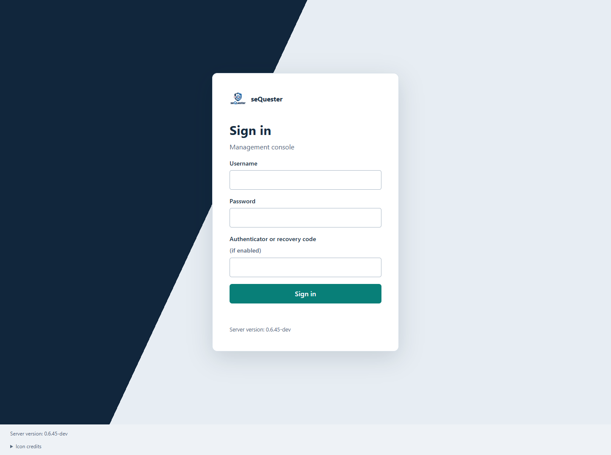
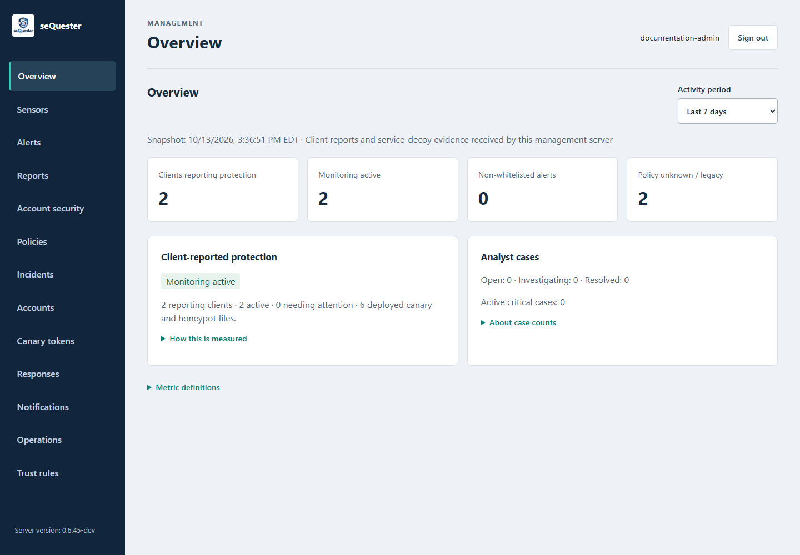
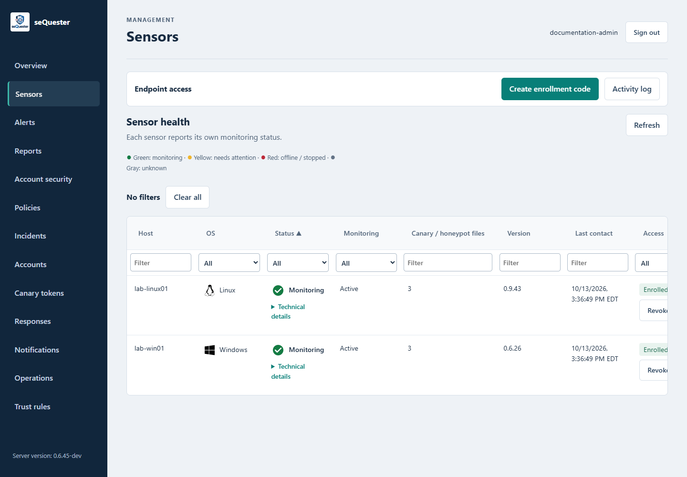
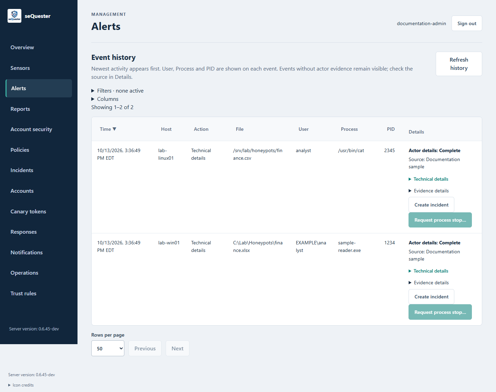
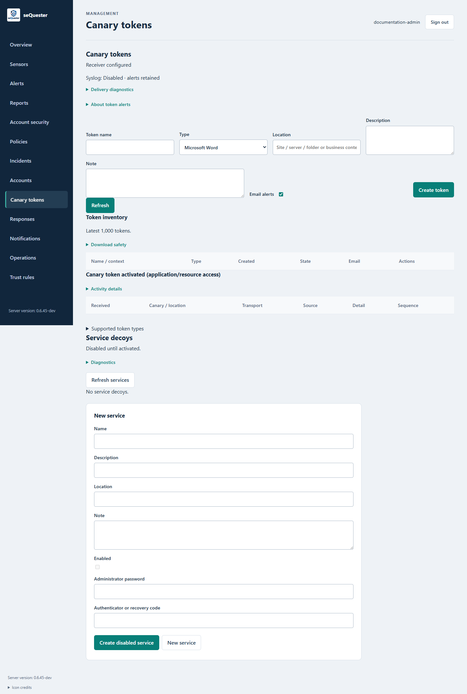
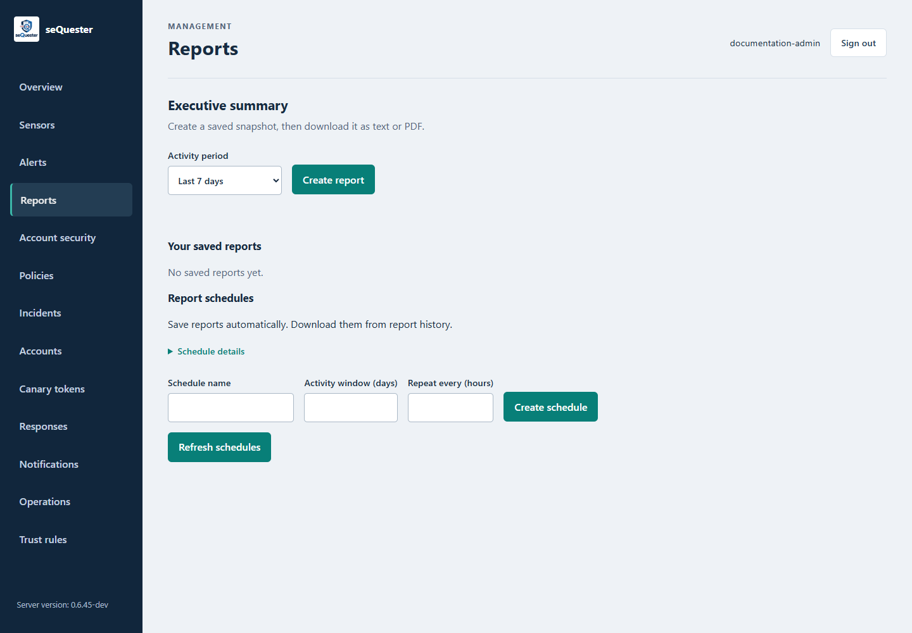

# User guide

## What seQuester does

seQuester helps security teams identify access to decoy files and resources that should attract little legitimate activity. Sensors report local file operations. Canary receivers record resource callbacks. The management console brings those observations together with available user, process and executable evidence.

Use the console to find affected hosts, examine the actor, retain evidence, group related activity into incidents and review approved response actions. Capture coverage depends on the operating system, monitoring source and installed components; see [Capabilities](CAPABILITIES.md).

## Sign in

Open the management address provided by your administrator. Enter your username and password, or use a configured single sign-on provider. Complete the authenticator challenge when required.

**Account security** provides password and authenticator controls. Save recovery codes when they are issued; each code works once. If the server requires a password change or authenticator enrollment, complete that step before returning to other screens.

Sessions expire after 30 minutes in the current source. Sign in again when prompted. Do not repeatedly submit an action whose result is uncertain; check the saved state or action history first.

All screenshots in this guide show an isolated development server with synthetic documentation data.

## Check the overview

**Overview** shows client-reported monitoring state and activity within the selected period. It also shows analyst case counts.

| Measure | How to read it |
| --- | --- |
| Clients reporting protection | Sensors that submitted structured protection information. |
| Monitoring active | Reporting sensors whose monitoring state is active. |
| Non-whitelisted alerts | Activity classified as an alert under validated policy evidence. |
| Policy unknown / legacy | Activity without sufficient validated policy information. |
| Analyst cases | Cases created by analysts, independent of the selected activity period. |

A zero alert count does not establish that every host is monitored. Check sensor status and the policy-unknown count alongside it. The current Overview refresh issue is recorded in [Capabilities](CAPABILITIES.md).

## Find a sensor

Open **Sensors**. The table shows host, OS, status, monitoring state, deployed file count, version, last contact and enrollment access.

- **Green:** monitoring.
- **Yellow:** needs attention.
- **Red:** offline or stopped.
- **Gray:** unknown or insufficient status information.

Use the column filters to narrow the list. **Clear all** restores the full list. Open **Technical details** to review why a particular status was assigned.

Enrollment and monitoring are separate. An enrolled sensor may be offline, stopped or missing a usable monitoring source. Version and last-contact fields are reported evidence, not proof of a successful upgrade.

## Investigate an event

1. Open **Alerts** and expand **Filters**.
2. Narrow by host or OS, time range and other available fields. IP and notification filters apply to recorded event data, not to an assumed attacker identity.
3. Review the file, user, process, PID and observation time.
4. Expand **Technical details** and **Evidence details** to inspect the source, operation, attribution and collection status.
5. Link the event to an incident when investigation is needed.

Use **Columns** to choose the information shown in the list. Sort and page through results rather than assuming the first page is the complete history.

**Actor details: Complete** means the displayed user, process and PID are present. It does not mean the executable was preserved, its signature was verified, or the accessing thread's token was captured. Review those evidence fields separately.

### Questions to answer

| Question | Evidence to inspect |
| --- | --- |
| Which process acted? | PID, process start identity, sensor identity, executable path and source-event linkage. |
| Which user acted? | Event subject, process owner and effective thread or filesystem identity, with collection status. |
| Is the executable what it claims to be? | SHA-256, stable file identity, signature evidence, original filename and location. |
| What happened? | Operation, target, result/status, rename paths and available byte/offset information. |
| Do we have the binary? | Preservation status, evidence ID, matching hashes and central upload status. |
| What happened next? | Related events, source ordering, server sequence, incident history and response receipts. |

A process named `notepad.exe` is not verified by its name. A valid signature is evidence about the binary's publisher and integrity; it is not a safety verdict. Missing data remains unavailable rather than being filled from a different process or a later user context.

## Manage incidents

Open **Incidents**, or choose **Create incident** from an event. Give the case a clear title and select severity. Link related events, assign an owner, add investigation notes and update the case status.

An incident groups the investigation; it does not automatically confirm malicious activity. Preserve source-event identifiers in your notes and exports. The incident export workflow is separate from summary reports and executable downloads.

## Review canary activity

Open **Canary tokens** to see token inventory and activations. A callback records the token, receiving time, transport and available source information.

Canary callbacks and local honeypot events answer different questions:

- A local sensor can identify the process touching a monitored file when its source captures that evidence.
- A remote callback can show that a token was used. It generally cannot identify the remote machine's local username, executable or PID.
- The source IP may belong to a proxy, resolver, gateway or scanning service. Match it with other evidence before assigning an actor or host.

An application's external-resource policy may prevent a callback. Copying a file alone does not guarantee that its embedded token will activate. Opening it in every supported consumer remains a distinct acceptance test.

## Use trust rules

**Trust rules** lets an administrator permit specific user or process operations without generating an alert. Matching events stay in history. Rules may be created without an existing event.

Ask for the narrowest exception that covers the legitimate activity: the intended sensor or group, verified identity, target and operations. **Read only** does not permit write, rename or delete. **Edit** selects write, append and truncate; rename and delete are separate choices.

An always-alert rule takes precedence over a matching log-only whitelist. A missing hash cannot satisfy a verified hash rule. See the [Administrator guide](ADMINISTRATOR-GUIDE.md) for authoring and publication.

## Review responses

**Responses** shows requested actions and receipts. Available process-stop workflows require server authorization, sensor-side permission and exact process identity checks. A queued request is not proof that a process stopped.

Broad active response remains incomplete. Resource blocking, account disabling, session revocation and host isolation are not established as operational features in this snapshot. See [Capabilities](CAPABILITIES.md) before relying on enforcement.

## Create reports

In **Reports**, select an activity period and choose **Create report**. The saved snapshot can be downloaded as text or PDF. Saved reports and schedules provide a repeatable reporting workflow.

A report reflects its recorded snapshot. It does not update when later events arrive. Schedules save reports; the visible workflow does not imply automatic email delivery.

## When something looks wrong

| Symptom | Next step |
| --- | --- |
| A sensor is enrolled but not monitoring | Check last contact and Technical details; ask the administrator to inspect the sensor service and native source. |
| An event has no user or PID | Check its source and collection status. Remote callbacks and unsupported local contexts may not provide them. |
| A legitimate read still alerts | Compare the rule's scope, operation, time, identity and binary hash; check the applied policy receipt. |
| A canary does not call back | Confirm the token is active, the receiver is reachable and the application permits its trigger mechanism. |
| An export or action appears to fail | Check its history or delivery receipt before retrying. |
| A page reports an expired session | Sign in again; verify any previous submission independently. |

Administrators have additional recovery procedures in [Deployment and operations](DEPLOYMENT-AND-OPERATIONS.md).
